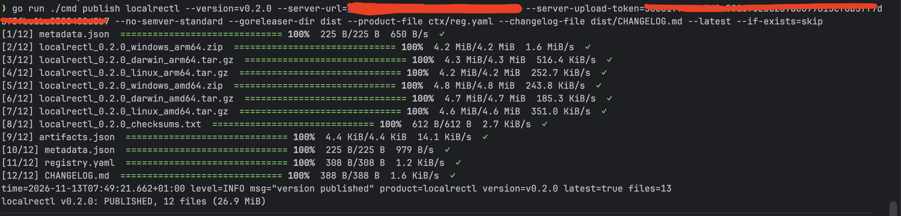
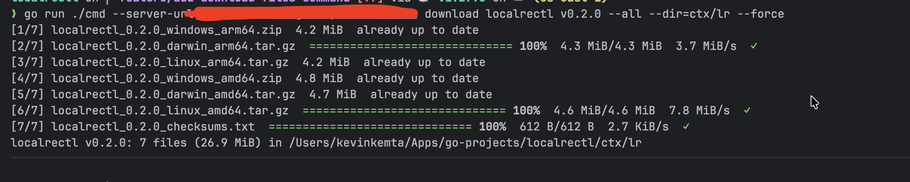

# localrectl

[](https://github.com/nivekalara237/localrectl/actions/workflows/patch.yml)
[](https://github.com/nivekalara237/localrectl/actions/workflows/security.yml)
[](https://codecov.io/gh/nivekalara237/localrectl)
[](https://github.com/nivekalara237/localrectl/actions/workflows/release.yml)
[](https://github.com/nivekalara237/localrectl/releases)
[](go.mod)
[](LICENSE)

**`localrectl` is the command-line client of [local-registry](https://github.com/nivekalara237/local-registry).**

local-registry is a private server where your teams store the versions of their internal deliverables: binaries, archives, configuration bundles, any file. `localrectl` talks to this server for you, from your terminal or from a CI pipeline.

- local-registry repository: https://github.com/nivekalara237/local-registry
- local-registry documentation: https://local-registry.nivekaa.com

## Table of contents

- [What localrectl does](#what-localrectl-does)
- [Install](#install)
  - [From the GitHub releases](#from-the-github-releases-recommended)
  - [With Docker](#with-docker)
  - [From the source code](#from-the-source-code)
- [Getting started](#getting-started)
- [Configuration](#configuration)
- [Commands](#commands)
  - [ping](#ping-check-the-server)
  - [validate](#validate-check-a-product-card)
  - [products](#products-list-every-product)
  - [products search](#products-search-find-a-product)
  - [versions](#versions-list-the-versions-of-a-product)
  - [release](#release-read-a-version)
  - [publish](#publish-send-a-new-version)
  - [download](#download-get-the-files-of-a-version)
  - [Other commands](#other-commands)
- [Exit codes](#exit-codes)
- [Security](#security)
- [Contributing](#contributing)
- [License](#license)

## What localrectl does

`localrectl` covers the two sides of local-registry:

- **Reading**: find a product, see its versions, read what a version holds, download its files and check them. No token needed.
- **Publishing**: check a product card, then send a new version to the server. Sending needs an upload token.


## Install

Choose one of these three ways.

### From the GitHub releases (recommended)

Each version is on the [releases page](https://github.com/nivekalara237/localrectl/releases), for Linux, macOS and Windows, on `amd64` (Intel, AMD) and `arm64` (Apple Silicon, ARM servers).

On Linux or macOS, set the version and your platform, then download and unpack the archive:

```sh
VERSION=1.0.0      # the version you want, without the "v"
OS=linux           # linux or darwin (macOS)
ARCH=amd64         # amd64 or arm64

curl -fsSLO "https://github.com/nivekalara237/localrectl/releases/download/v${VERSION}/localrectl_${VERSION}_${OS}_${ARCH}.tar.gz"
curl -fsSLO "https://github.com/nivekalara237/localrectl/releases/download/v${VERSION}/localrectl_${VERSION}_checksums.txt"
sha256sum --ignore-missing -c "localrectl_${VERSION}_checksums.txt"    # on macOS: shasum -a 256 --ignore-missing -c
tar xzf "localrectl_${VERSION}_${OS}_${ARCH}.tar.gz" localrectl
sudo mv localrectl /usr/local/bin/
```

The `sha256sum` line checks that the archive is the one that was built. It must print `OK`.

On Windows, download `localrectl_<version>_windows_amd64.zip` (or `_arm64.zip`) from the releases page, unzip it, and put `localrectl.exe` in a folder of your `PATH`.

### With Docker

The image holds only `localrectl`. Nothing to install: give the settings with `-e`, and the command after the image name.

```sh
docker run --rm -e LOCAL_REGISTRY_URL=https://registry.example.com \
  nivekalara237/localrectl ping
```

To read a file of the current folder, such as a product card, mount the folder:

```sh
docker run --rm -e LOCAL_REGISTRY_URL=https://registry.example.com \
  -v "$PWD:/work" -w /work \
  nivekalara237/localrectl validate registry.yaml
```

### From the source code

You need [Go](https://go.dev/dl/) 1.27 or later.

```sh
git clone https://github.com/nivekalara237/localrectl.git
cd localrectl
go build -o localrectl ./cmd
sudo mv localrectl /usr/local/bin/
```

### Check the install

```sh
localrectl version
```

## Getting started

**1. Tell `localrectl` where your server is.** Without this step, it uses `http://localhost:8077`.

```sh
export LOCAL_REGISTRY_URL=https://registry.example.com
```

**2. Check that the server answers.**

```sh
localrectl ping
```

**3. Find a product, then its versions, then the content of a version.**

```sh
localrectl products search --query billing
localrectl versions billing-agent
localrectl release billing-agent latest
```

**4. Download the files of a version.**

```sh
localrectl download billing-agent
```

**5. Check your product card, then publish a new version.**

```sh
localrectl validate registry.yaml
localrectl publish billing-agent --root ./out --version 1.2.0 --product-file registry.yaml
```

## Configuration

Each setting can come from four places. When a setting is given in several places, the first one of this list wins:

1. a flag on the command line, such as `--server-url`
2. an environment variable, such as `LOCAL_REGISTRY_URL`
3. the config file
4. the default value

| Flag               | Environment variable          | Config file key       | Default                 | What it does                                                  |
|--------------------|-------------------------------|-----------------------|-------------------------|---------------------------------------------------------------|
| `--server-url`     | `LOCAL_REGISTRY_URL`          | `server.url`          | `http://localhost:8077` | Address of the server                                         |
|                    | `LOCAL_REGISTRY_UPLOAD_TOKEN` | `server.upload-token` |                         | Upload token, needed only to publish                          |
| `--server-ca-file` | `LOCAL_REGISTRY_CA_FILE`      | `server.ca-file`      |                         | Certificate of your company, for an internal HTTPS server     |
| `--config`         | `LOCAL_REGISTRY_CONFIG`       |                       |                         | Config file to read                                           |
| `-o, --output`     | `LOCAL_REGISTRY_OUTPUT`       | `output`              | `text`                  | `text` to read it, `json` for scripts and `jq`                |
| `-v, --verbose`    | `LOCAL_REGISTRY_VERBOSE`      | `verbose`             | `false`                 | Show the details: config file used, requests sent…            |
| `-q, --quiet`      | `LOCAL_REGISTRY_QUIET`        | `quiet`               | `false`                 | Show only the result and the errors                           |
| `--no-color`       | `LOCAL_REGISTRY_NO_COLOR`     | `no-color`            | `false`                 | No colors                                                     |
| `--timeout`        | `LOCAL_REGISTRY_TIMEOUT`      | `timeout`             | `300`                   | Time limit of a request, in seconds                           |
| `--retries`        | `LOCAL_REGISTRY_RETRIES`      | `retries`             | `3`                     | Retries after a network or server error                       |
| `--exit-code`      | `LOCAL_REGISTRY_EXIT_CODE`    | `exit-code`           | `1`                     | Exit code of a failed command (see [Exit codes](#exit-codes)) |

### The config file

Without `--config`, `localrectl` looks for a file named `config`, `config.yaml` or `config.yml` in these folders, in this order: `/etc/localrectl/`, `~/.lr/`, then the current folder. It reads the first one it finds.

```yaml
server:
  url: https://registry.example.com
  upload-token: "your-token"
  ca-file: ~/certs/company-ca.pem
output: text
timeout: 300
retries: 3
```

Always write the token between quotes: without them, a token made only of digits is read as a number and refused.

To see the settings `localrectl` uses, and where each one comes from:

```sh
localrectl config
```

## Commands

Every command accepts `--help`, which shows all its options and more examples.

### `ping`: check the server

Checks that the server answers, and tells you whether an upload token is set.

```sh
localrectl ping
```

### `validate`: check a product card

Checks a `registry.yaml` file against the rules of the server, so you find mistakes before you publish. The file is read on your machine; only the rules are downloaded from the server.

Add `--artifacts` to also check the `artifacts.json` file that goreleaser writes.

```sh
localrectl validate registry.yaml
localrectl validate registry.yaml --artifacts dist/artifacts.json
```

### `products`: list every product

Lists all the products of the server. Every page is read, so the list is complete.

```sh
localrectl products
localrectl products -o json | jq -r '.products[].product'
```

### `products search`: find a product

Searches the products by criteria. Each option narrows the search, and a product must match all of them.

```sh
localrectl products search --query billing
localrectl products search --keyword vcs --keyword plugin
localrectl products search --label team=devtools --owner devtools@example.com
localrectl products search --updated-since 2026-01-01
```

- `-Q, --query TEXT`: a text to find in the name, the display name or the description
- `-k, --keyword K`: a keyword of the product (repeat it to ask for several)
- `-l, --label key=value`: a label of the product (repeat it to ask for several)
- `--owner O`: a name or an email of the owners
- `--license L`: a license, such as `MIT` or `Apache-2.0`
- `--deprecated`: only the deprecated products; `--deprecated=false` for the others
- `--prerelease`: only the products that have a prerelease; `--prerelease=false` for the others
- `--updated-since DATE`: products updated on or after this date, such as `2026-01-31`
- `--sort KEY`: the order of the list
- `--limit N`: how many products per page

A search returns one page. When more pages exist, `localrectl` tells you how to get the next one:

- `-c, --cursor C`: read the page `C`
- `--all`: read every page at once

```sh
localrectl products search --query plugin --limit 20
localrectl products search --query plugin --limit 20 --cursor <next>
localrectl products search --query plugin --all
```

### `versions`: list the versions of a product

Lists the published versions of a product, and shows which one is the latest and which ones are deprecated. Add `--prerelease` to also see the test versions.

```sh
localrectl versions billing-agent
localrectl versions billing-agent --prerelease
```

### `release`: read a version

Shows the `release.json` of a version: its files, their sha256 and its details. Write `latest` instead of a version number to read the latest one.

```sh
localrectl release billing-agent v1.2.0
localrectl release billing-agent latest
```

### `publish`: send a new version

Sends the files of a new version to the server, each one with its sha256, then publishes the version. It needs the upload token. A published version never changes.

```sh
localrectl publish <product> --version <version> --product-file <registry.yaml> [flags]
```

The files come from one of two places:

- **A goreleaser build**: the files listed in its `artifacts.json`, with `artifacts.json` and `metadata.json`. It is used with `--goreleaser-dir` or `--goreleaser-artifacts-file`, or when the root folder holds an `artifacts.json`.
- **A folder**, `--root` (the current folder by default): every file in it. A subfolder fails, unless `--skip-subdirs` skips it or `--compress-subdirs` sends it as one archive.

The product card, `--product-file`, is checked against the rules of the server, then sent as `registry.yaml`.

```sh
# The files of a folder
localrectl publish billing-agent --root ./out --version 1.2.0 --product-file registry.yaml

# A goreleaser build, made the latest version
localrectl publish billing-agent --goreleaser-dir dist --version 1.2.0 --product-file registry.yaml --latest

# Each subfolder of ./out sent as a zip archive
localrectl publish billing-agent --root ./out --version 1.2.0 --product-file registry.yaml \
  --compress-subdirs --compress-type zip

# What would be sent, without sending anything
localrectl publish billing-agent --root ./out --version 1.2.0 --product-file registry.yaml --dry-run
```



Options:

- `--version V`: the version, `X.Y.Z` or `X.Y.Z-pre`; for a goreleaser build, by default the tag (else the version) of `metadata.json`
- `--no-semver-standard`: accept a version that is not `X.Y.Z`, such as `v1.2.0`
- `--product-file F`: the product card (required)
- `--changelog-file F`: the changelog, sent as `CHANGELOG.md`
- `-R, --root DIR`: the folder of the files to send
- `--goreleaser-dir DIR`: the goreleaser build folder (`dist`), with its `artifacts.json` and `metadata.json`
- `--goreleaser-artifacts-file F`, `--goreleaser-metadata-file F`: the `artifacts.json` and `metadata.json` of a goreleaser build, given one by one
- `--exclude NAME`: a file or subfolder of the root folder not to send, by name (repeatable)
- `--exclude-match PATTERN`: a pattern of the files and subfolders of the root folder not to send, such as `'*.log'`
- `--skip-subdirs`: skip the subfolders of the root folder
- `--compress-subdirs`: send each subfolder as one archive; `--compress-type tar.gz|zip` (`tar.gz` by default)
- `--latest`: also make this version the latest one
- `--if-exists fail|skip`: if the version is already published, fail (the default), or succeed without sending anything
- `--no-validate`: skip the checks of the product card and of `artifacts.json`
- `--dry-run`: show what would be sent, and send nothing (no token needed)

### `download`: get the files of a version

Downloads files of a version and checks each one against the sha256 of its `release.json`. Without a version, it takes `latest`.

```sh
localrectl download <product> [version] [flags]
```

The files are chosen from the `release.json`:

- `--file NAME`: these files, by name (repeatable)
- `--all`: every file of the version, the checksums file included
- `--os`, `--arch`, `--kind`: every file that matches; a file with no os or arch fits any
- none of them: the archive of this machine (its os and arch), a zip on Windows and a tar.gz elsewhere

Each file is written to a temporary file, checked, then renamed: a corrupted file never reaches the destination folder. A file already there with the same sha256 is not downloaded again; a different one fails, unless `--force` replaces it.

```sh
# The archive of this machine, for the latest version, in the current folder
localrectl download billing-agent

# The linux arm64 files of a version, in /opt/billing-agent
localrectl download billing-agent v1.2.0 --os linux --arch arm64 -d /opt/billing-agent

# Precise files
localrectl download billing-agent v1.2.0 --file billing-agent_1.2.0_linux_amd64.tar.gz

# The archive of this machine, extracted in /opt/billing-agent
localrectl download billing-agent --extract -d /opt/billing-agent

# Every file of the version
localrectl download billing-agent v1.2.0 --all -d ./billing-agent

# What would be downloaded, without downloading anything
localrectl download billing-agent --all --dry-run
```



Options:

- `--file NAME`, `--all`, `--os OS`, `--arch ARCH`, `--kind KIND`: the files to download (see above); `--os` takes `linux`, `darwin` (or `macos`) or `windows`, `--kind` takes `archive`, `binary`, `package`, `file` or `source`
- `-d, --dir DIR`: the destination folder, created if missing (the current folder by default)
- `--force`: replace a file, or an extracted entry, that differs from the downloaded one
- `--extract`: extract the downloaded archives (tar.gz or zip) into `--dir`; the archives are kept. Only folders and regular files are extracted: a link, or an entry that would land outside `--dir`, fails
- `--no-verify`: skip the sha256 check (not recommended)
- `--dry-run`: show what would be downloaded, and download nothing

#### Check the signature

`--verify-signature` checks the [Sigstore](https://www.sigstore.dev/) signature of the checksums file of the version with [cosign](https://docs.sigstore.dev/cosign/system_config/installation/), which must be installed. Then each file must be listed in that signed file with the sha256 of the `release.json`. Nothing is downloaded when a check fails.

The expected signer is given in one of two ways:

- `--key FILE`: the public key of the signer
- `--certificate-identity ID` (or `--certificate-identity-regexp REGEXP`) with `--certificate-oidc-issuer URL`: the identity of the signer in its certificate (cosign keyless)

```sh
# Signed with a key
localrectl download billing-agent --verify-signature --key cosign.pub

# Signed by the release workflow of a GitHub repository, with cosign keyless
localrectl download billing-agent --verify-signature \
  --certificate-identity-regexp '^https://github.com/acme/billing-agent/' \
  --certificate-oidc-issuer https://token.actions.githubusercontent.com
```

The signature must be recorded in the Sigstore transparency log (Rekor).

### Other commands

- `localrectl config`: show the settings in use, and where each one comes from
- `localrectl version`: show the version of `localrectl`
- `localrectl completion bash|zsh|fish|powershell`: print the auto-completion script for your shell

## Exit codes

When a command ends, it returns a number to the shell. A CI pipeline uses it to know whether the step failed.

| Code | Meaning                                                                 |
|------|-------------------------------------------------------------------------|
| 0    | Success                                                                 |
| 1    | Failure, or the number given to `--exit-code`                           |
| 2    | Bad use of the command: unknown option, missing argument, wrong setting |

```sh
localrectl validate registry.yaml --exit-code 3
```

## Security

- **Never type the upload token on the command line.** Anyone on the machine can see it with `ps`, and it stays in the history of your shell. Put it in the `LOCAL_REGISTRY_UPLOAD_TOKEN` variable, or in the config file.
- **Protect the config file that holds the token**, so that only you can read it: `chmod 600 ~/.lr/config`. `localrectl` warns you when other users can read it.
- **`localrectl` never shows the token**, not even with `--verbose` or `localrectl config`.
- **The token is only for publishing.** Reading products and versions needs no token.
- **To report a vulnerability**, do not open a public issue: use a [private security advisory](https://github.com/nivekalara237/localrectl/security/advisories/new).

## Contributing

Issues and pull requests are welcome. Before you open a pull request, check that this command passes:

```sh
gofmt -l . && go vet ./... && go test -race ./...
```

## License

`localrectl` is under the MIT license: see [LICENSE](LICENSE) and [NOTICE](NOTICE).
